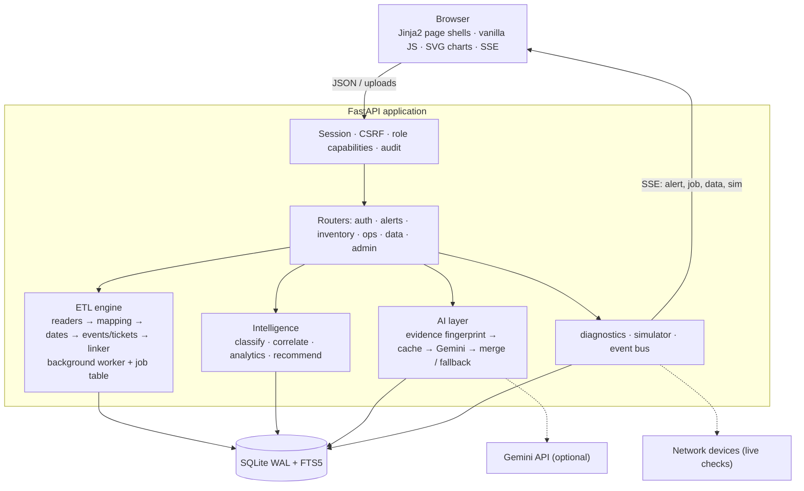
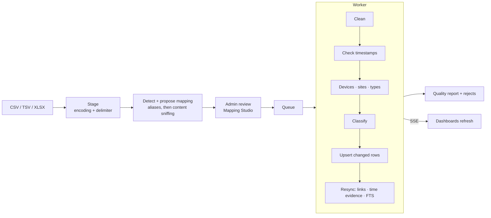

# NOCTURNE

NOCTURNE is a network alert triage console for the Ferguson NOC. It is one Python service with its own web UI, one SQLite database and one configuration file.

It imports monitoring event exports (SolarWinds) and ServiceNow ticket exports from the browser, links them together, and gives every alert a five-stage triage:

1. **Alert analysis**: the device, its site and what the monitoring tool reported.
2. **Log investigation**: recovery, flapping, other devices down at the same site, and the device timeline.
3. **Ticket history**: similar past tickets, ranked, with the reasons they match and what fixed them.
4. **Preliminary checks**: ping, traceroute, DNS and service ports, either simulated or live.
5. **Recommendation**: a hypothesis, evidence, next steps, the group to route to and a ready-to-paste work note. It comes from the built-in engine and, optionally, from Gemini (cached and clearly labelled).

The detailed guide covers architecture, data-flow diagrams, every mapping rule, scoring formula, configuration key and API endpoint. It is at [`docs/NOCTURNE-Guide.html`](docs/NOCTURNE-Guide.html) and is also served in the app at `/guide`.

## Quick start

**Option 1: Shell script (easiest)**
```bash
./run.sh                          # http://localhost:8080
./run.sh dev                       # Run frontend dev server + backend together
./run.sh build                     # Build frontend, then start backend
```

**Option 2: Manual setup**
```bash
python -m venv .venv && source .venv/bin/activate        # Windows: .venv\Scripts\activate
pip install -r requirements.txt
python run.py                                               # http://localhost:8080
python run.py dev                                           # Frontend + backend dev servers
python run.py build                                         # Build frontend first
```

Getting started:
1. Sign in as `admin` with the password `ChangeMe@2026`, which you must change at once. Set `NOCTURNE_ADMIN_PASSWORD` beforehand to choose it yourself.
2. In **Data Studio**, drop the event export and the ticket export together and review the proposed column mapping. Then start the imports. The full 30-day export (134K events) imports in about 17 seconds. Small test files are in `samples/`.
3. Explore **Overview** and **Alerts**, and select any alert card to run its triage.
4. Optional: `export GEMINI_API_KEY=…` before starting, to turn on AI analysis.

Run the tests with `pip install pytest && python -m pytest -q tests`.

## What's inside

| Area | Highlights |
|---|---|
| Overview | KPIs with change against the previous period, alerts by hour of day, volume by severity, US state tile map, noisiest devices and sites, event types, categories, ticket knowledge. Everything links to filtered lists. |
| Alerts | Colour-coded cards (severity, category, up/down, state, simulated or custom), full-text, IP and site search, live facet counts, actionable-only switch, live arrivals, bulk acknowledge/resolve, CSV export |
| Triage | The five stages above, with a progress rail, tick-off steps, feedback that improves future ranking, and copyable work notes |
| Devices, sites, tickets | Health rings, outages and recovery times, flapping, peers, linked tickets, parsed work-note timelines, "what fixed it" |
| Simulator (admin) | Random alerts, site outage cascade, flapping interface, power event, WAN failover, and custom alerts with a live classification preview |
| Data Studio (admin) | Upload, auto-detection and Mapping Studio review, background imports with live progress, quality reports and rejected rows, event catalogue editor, resync and purges |
| Admin | People and roles, role matrix, audit trail, effective settings with secrets masked, AI and query cache statistics |

Ferguson branding (navy `#00446A`, grey `#77787B`, white, and the Ferguson logo) is used throughout, in day and night themes. The layout works down to phone width, and fonts are served locally so the app runs on air-gapped networks.

### Data handling
- **Timestamps**: every event needs its own date and time. Day/month order is proven per column from the values; missing, time-only, date-only, impossible, pre-2000 and future timestamps are rejected with the reason. Same-minute events are ordered by EventID.
- **Re-uploads**: unchanged records are skipped, changed ones updated, duplicate rows in a file collapsed, older (or unversioned) ticket rows never overwrite newer ones, and analyst alert states are never touched.
- **Resync**: one routine (run after every import and from Data Studio) rebuilds device counters, sites, ticket links with alert-time evidence, and search, so events and tickets can be uploaded alone or together, in any order.
- **Time evidence**: a ticket's stated incident start ("Start time: …", validated against its opening) or its opening time is compared with alerts on the linked device or site, but only where imported events cover that time.

## Roles

| Role | Can |
|---|---|
| **NOC Analyst** (`user`) | View dashboards, alerts and inventory; triage; run checks; acknowledge or resolve; give feedback; export; ask the AI |
| **Administrator** (`admin`) | Everything above, plus import data, edit the event catalogue, purge, simulate and trigger custom alerts, manage users, view the audit trail and settings |

The capability table lives in `nocturne.toml`, under `[roles]` and `[permissions]`.

## Architecture



## Import data flow



## Configuration

Everything is configured in **`nocturne.toml`**: storage, security, roles, diagnostics mode, AI mode and caching, correlation windows, scoring weights, link confidences, import aliases and extraction patterns, classification rules, the event catalogue, status labels and playbooks.

Secrets are read only from environment variables:

- `NOCTURNE_SECRET_KEY`
- `NOCTURNE_ADMIN_PASSWORD`
- `GEMINI_API_KEY`

Any setting can be overridden with an environment variable such as `NOCTURNE__DIAGNOSTICS__MODE=live`.

## Project layout

```
nocturne.toml          app configuration
run.py / run.sh        application launcher (supports dev and build modes)
requirements.txt       Python dependencies
app/                   config · db · schema.sql · cache · security · bus · web
app/api/               auth · alerts · inventory · ops · data · admin
app/services/          etl/ · classify · textmine · correlate · analytics · recommend · ai · diagnostics · simulator
frontend/              React + Vite application (builds to web/dist)
web/                   built frontend (dist/) and static files (fonts, images, css)
docs/                  NOCTURNE-Guide.html
samples/               small event and ticket exports
tests/                 pytest suite
```
